# mercurius-charts

Gráficos no padrão **Mercurius Research**, com a linguagem visual dos exhibits de Morgan Stanley Research, JPM Guide to the Markets e das figuras do FMI (WEO/GFSR): títulos que contam a conclusão, tipografia pequena e precisa, linhas finas, painéis numerados, anotações de eventos e etiquetas de valor.

```python
import mercurius_charts as mc
from mercurius_charts import formato as F

fig, ax = mc.figura("Cada halving antecedeu uma nova máxima do bitcoin",
                    "Preço em US$, escala logarítmica, semanal",
                    numero=1, fonte="Glassnode e Mercurius Research.", margem_dir=0.78)
mc.periodo(ax, "2021-11-10", "2022-11-21", "Bear market")
mc.linhas(ax, precos, log=True)
mc.evento(ax, "2024-04-20", "Halving")
mc.salvar(fig, "saida/fig01")      # PNG 300 dpi + SVG editável (Figma)
```

## Galeria

| | |
|---|---|
| 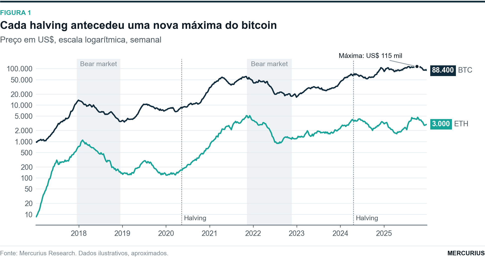 | 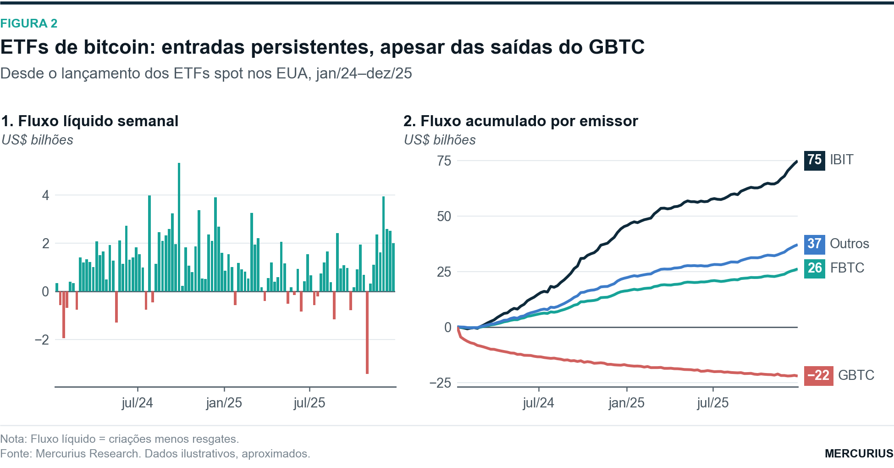 |
| 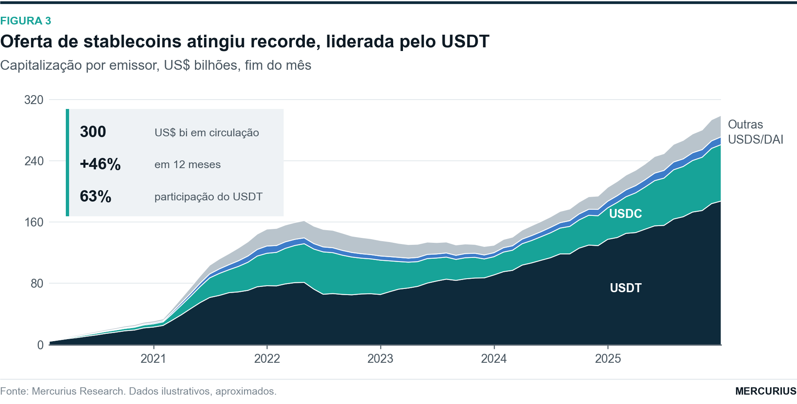 | 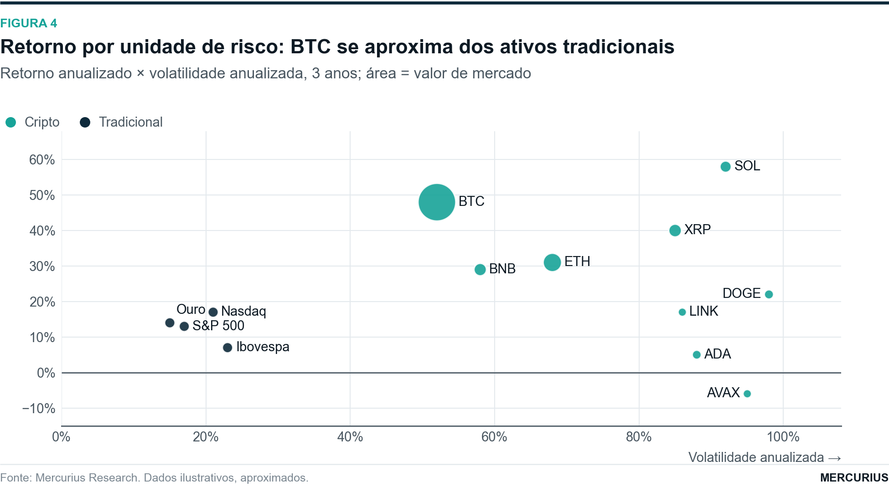 |
| 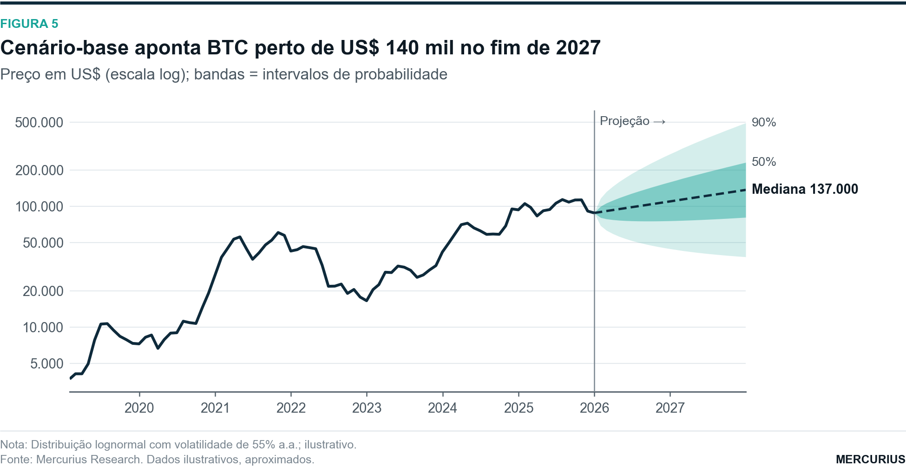 | 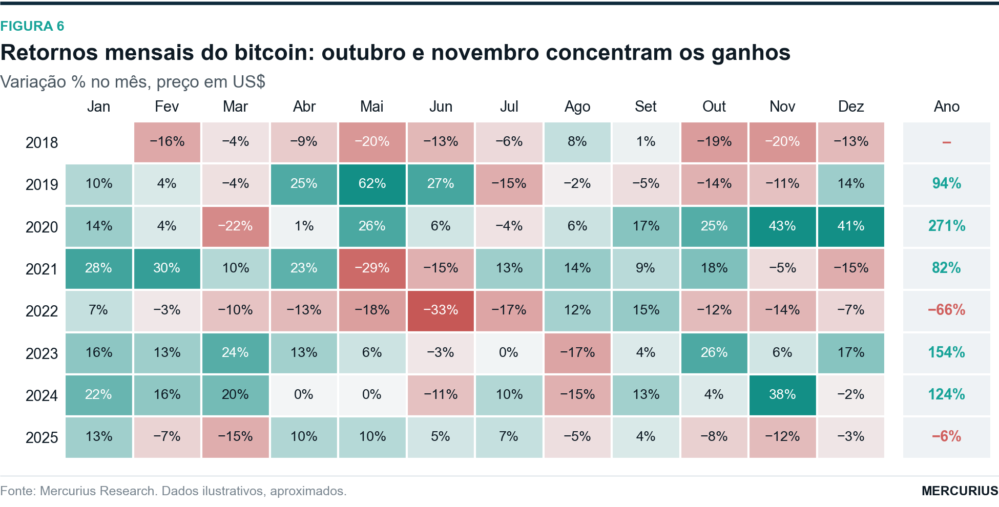 |
| 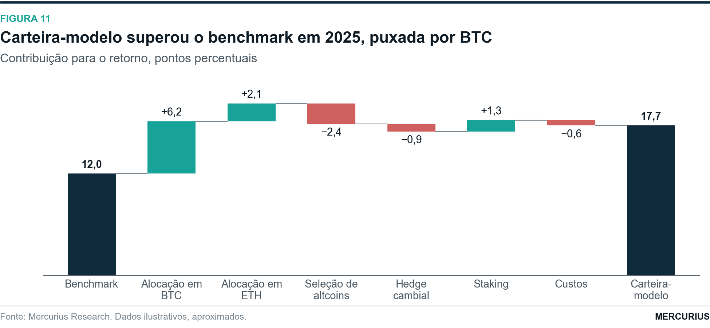 | 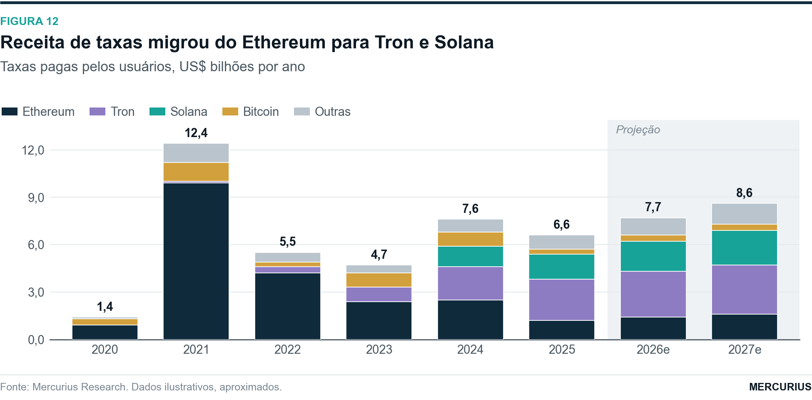 |
| 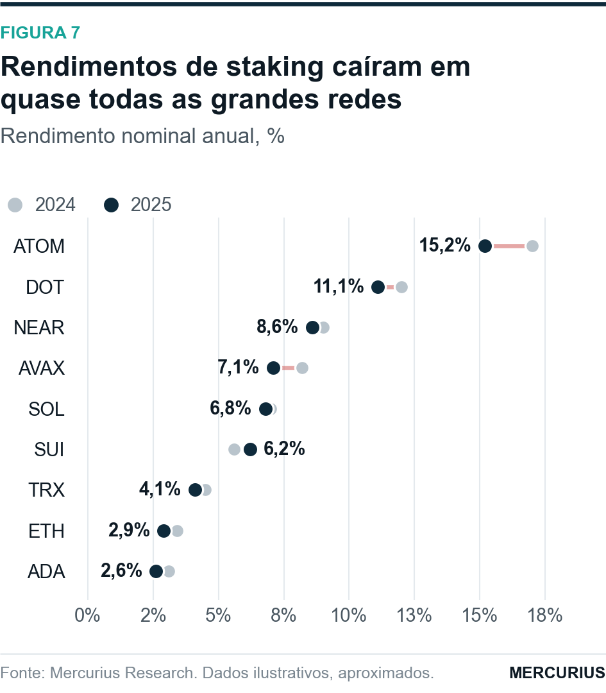 | 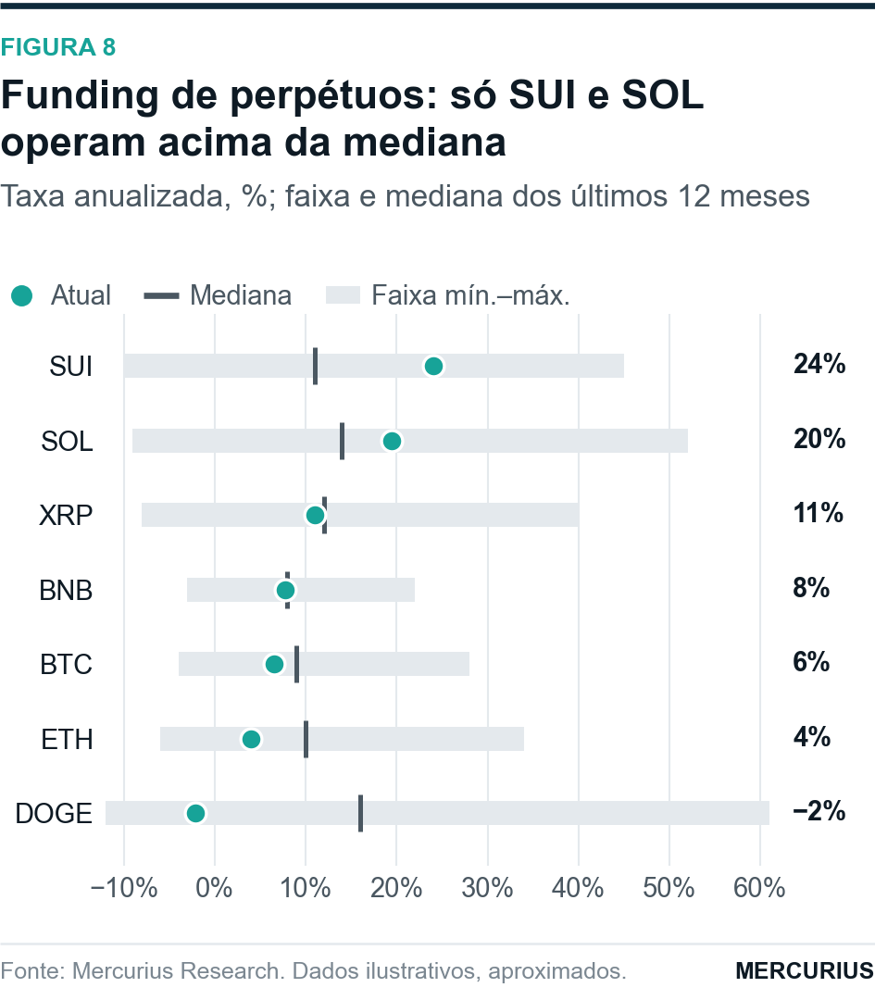 |
| 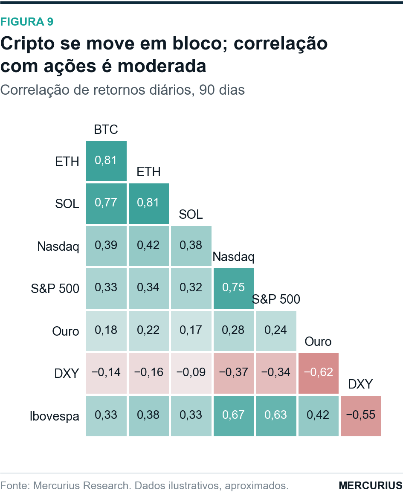 | 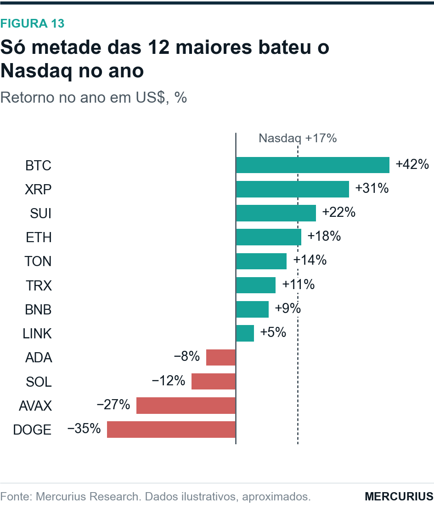 |
| 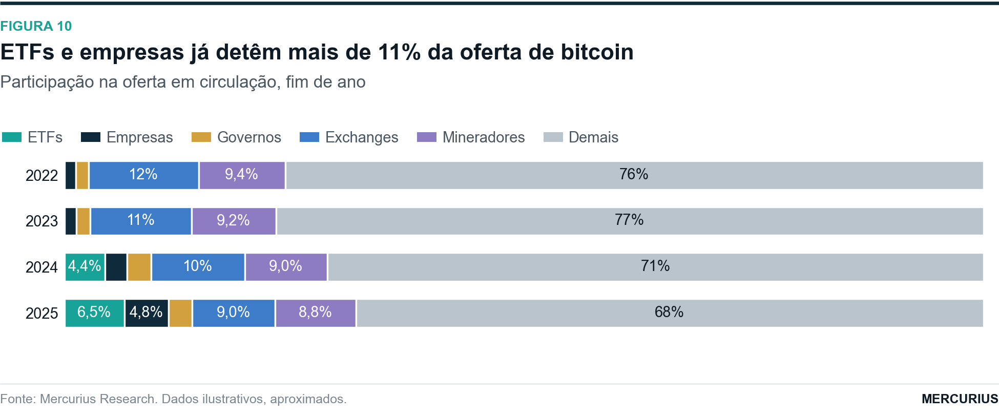 | 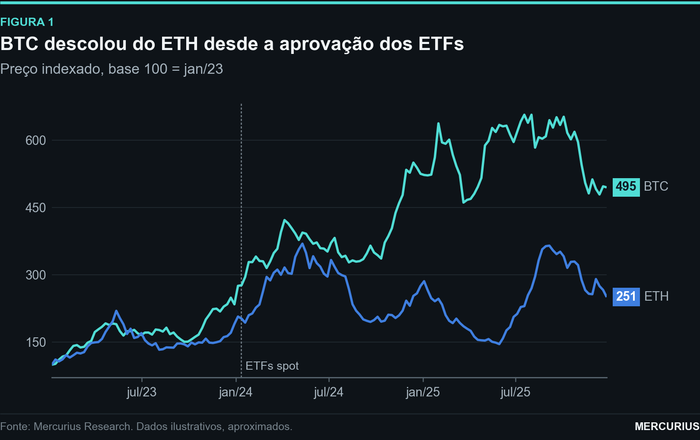 |

Os números da galeria são **ilustrativos**. Para regenerar: `python exemplos/galeria.py` (ou `... 1 5 9` para só algumas).

## Peças

**Moldura:** `mc.figura(titulo, subtitulo, numero, fonte, nota, paineis=(1, 2), titulos_paineis=[...])`

**Gráficos**

| Função | Uso |
|---|---|
| `linhas` | séries temporais, escala log, destaque e etiquetas na ponta |
| `area_empilhada` | composição ao longo do tempo, com rótulos dentro das faixas |
| `barras_tempo` | fluxos semanais e mensais (positivo/negativo) |
| `barras` | categorias e anos; agrupadas ou `empilhar=True`, faixa de projeção |
| `barras_horizontais` | ranking com linha de referência |
| `barras_100` | composição percentual |
| `dispersao` | risco × retorno, bolhas, rótulos sem colisão, regressão |
| `cascata` | ponte e atribuição de retorno |
| `leque` | projeção com bandas de probabilidade (fan chart do FMI) |
| `calendario` | heatmap de retornos ano × mês |
| `halteres` | antes × depois por categoria |
| `intervalos` | faixa mín.–máx. com valor atual e mediana |
| `correlacao` | matriz triangular |

**Anotações:** `periodo`, `evento`, `linha_ref`, `destacar`, `caixa` (estatísticas no estilo JPM), `etiquetas_finais`.

**Formatos BR:** `F.num`, `F.pct`, `F.pp`, `F.moeda`, `F.eixo_data`.

**Temas:** `claro` para relatórios e `escuro` para app e redes (`tema="escuro"`).

Regras do padrão em [CLAUDE.md](CLAUDE.md).
