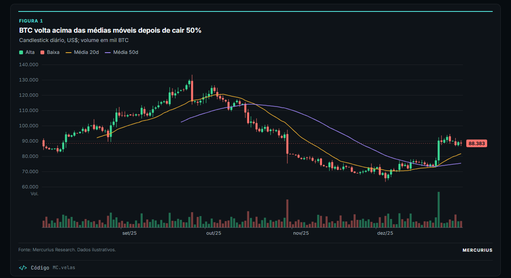
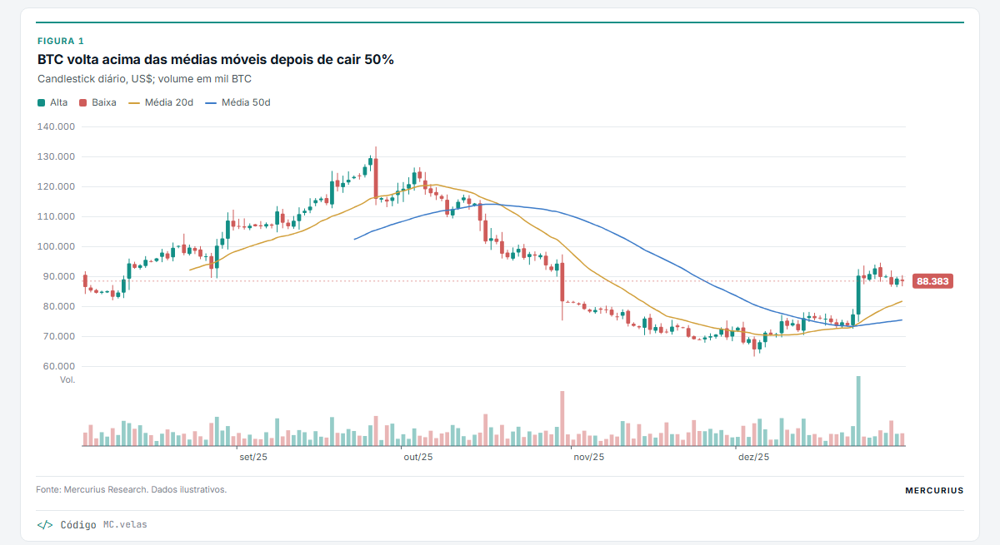
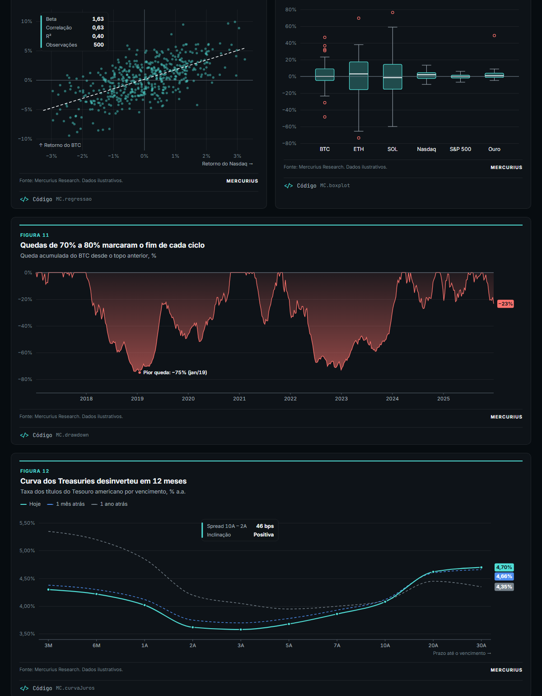
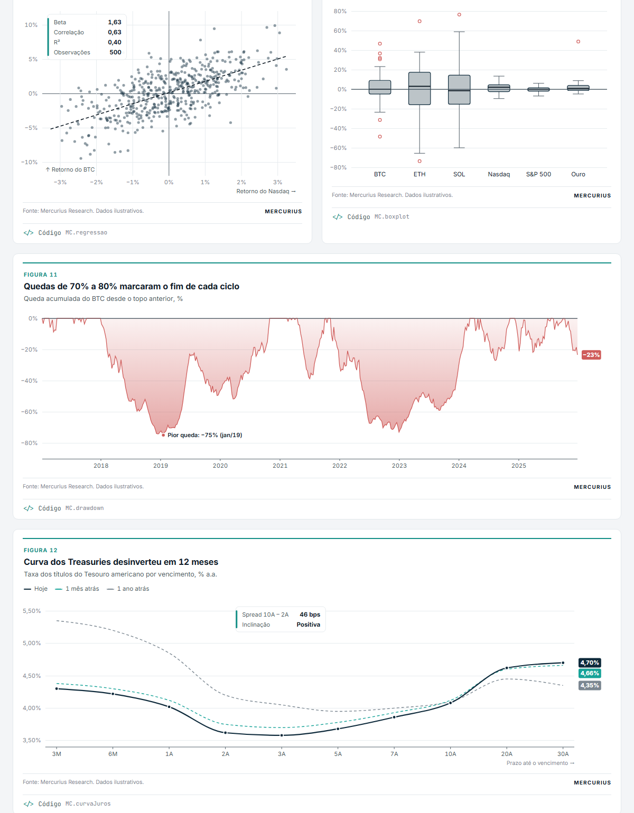

# Mercurius Charts

Template de gráficos da **Mercurius Research**. Os gráficos são desenhados por código, a partir dos dados, em versão **escura** (app e redes) e **clara** (relatórios). A linguagem visual segue os exhibits de Morgan Stanley Research, JPM Guide to the Markets e FMI: título que conta a conclusão, tipografia precisa, anotações e fonte em toda figura.

| Escuro | Claro |
|---|---|
|  |  |
|  |  |

## Como começar

1. Clique em **Use this template → Create a new repository** (ou clone este repositório).
2. Rode um servidor local na raiz:
   ```bash
   python -m http.server 8000
   ```
3. Abra a galeria em `http://localhost:8000/web/` para ver os 24 exemplos. Cada um tem o botão **</> Código** com a chamada que o gera.
4. Para uma análise nova, copie a pasta [`analise/`](analise/), troque os dados em `dados.js` e escreva os gráficos em `index.html`.

## Uso em 4 linhas

```html
<script src="https://cdnjs.cloudflare.com/ajax/libs/d3/7.9.0/d3.min.js"></script>
<script src="web/mercurius-charts.js"></script>
<div id="fig"></div>
<script>
  const [plot] = MC.figura("#fig", { numero: 1, titulo: "BTC volta acima das médias móveis",
                                     subtitulo: "Diário, US$", fonte: "Mercurius Research." });
  MC.velas(plot, { dados: ohlc, medias: [20, 50], volume: true });
</script>
```

**Tema de relatório:** `MC.figura(alvo, { tema: "relatorio" })` gera o exhibit no padrão de research de banco (Arial, azul-marinho, sem moldura nem marca), para PDFs.

**Tema:** a figura segue a página (`<html data-theme="light">` ou `"dark"`, ou o modo do sistema). Para forçar o tema numa figura só, use `MC.figura(alvo, { tema: "claro" })`.

## Catálogo (`web/mercurius-charts.js`)

| Grupo | Função | Uso |
|---|---|---|
| Preço e tendência | `MC.velas` | candlestick, `tipo: "ohlc"` ou `"heikin"`, médias móveis e volume |
| | `MC.renko` | tijolos atemporais, filtra ruído |
| | `MC.pontoFigura` | colunas de X e O, reversão configurável |
| | `MC.linhas` | linha, escala log, área, eventos, períodos, etiquetas na ponta |
| Estatísticos e quant | `MC.histograma` | distribuição de retornos, curva normal, VaR, curtose |
| | `MC.regressao` | dispersão com reta de MQO, beta, correlação, R² |
| | `MC.dispersao` | bolhas com rótulos sem colisão (risco × retorno) |
| | `MC.drawdown` | queda desde o topo, pior queda anotada |
| | `MC.curvaJuros` | curva por vencimento, comparação no tempo, spread |
| | `MC.boxplot` | quartis, mediana e outliers |
| | `MC.rrg` | Relative Rotation Graph em quadrantes, com rastro |
| | `MC.leque` | projeção com bandas de probabilidade (fan chart) |
| | `MC.calendario` | retornos mensais ano × mês |
| Fundamentalistas | `MC.colunas` | receita, EBITDA, lucro por trimestre, com projeção |
| | `MC.cascata` | ponte e DRE (subtotais com `[nome, null]`) |
| | `MC.rosca` | composição de carteira; `tipo: "pizza"` |
| | `MC.barrasHorizontais` | ranking com linha de referência |
| Fluxos | `MC.barrasTempo` | fluxos semanais e mensais (positivo/negativo) |
| Política e relatório | `MC.hemiciclo` | assentos de um parlamento por bloco, com linha de maioria |
| | `MC.halteres` | dois valores por categoria (meta × projeção, antes × depois) |
| | `MC.intervalos` | faixas de mínimo a máximo por item, com referência (projeções de bancos) |
| | `MC.tabela` | tabela no padrão Morgan Stanley (réguas azul-marinho, cabeçalho em faixa) |
| | `MC.linhaDoTempo` | barra de anos com eventos acima e abaixo, sem sobreposição (padrão Goldman) |
| | `MC.organograma` | estrutura de cargos com caixas coloridas e listas |
| | `MC.linhas({ anotacoes })` | eventos marcados na linha com losango, chamada e legenda de categorias |
| | `MC.areaEmpilhada` | composição no tempo com caixa de números |

Formatos BR em `MC.F`: `num`, `pct`, `pp`, `mil`, `mes`, `dia`.

## Estrutura

```
web/            biblioteca JS + galeria (index.html) + dados de exemplo
analise/        modelo para copiar e começar uma análise nova
mercurius_charts/, exemplos/   versão Python (PNG/SVG para PDF e Word)
docs/           imagens do README
CLAUDE.md       regras do padrão (para analistas e para IA)
```

Os dados de exemplo são ilustrativos. Para regenerá-los: `python web/gerar_dados.py`.
