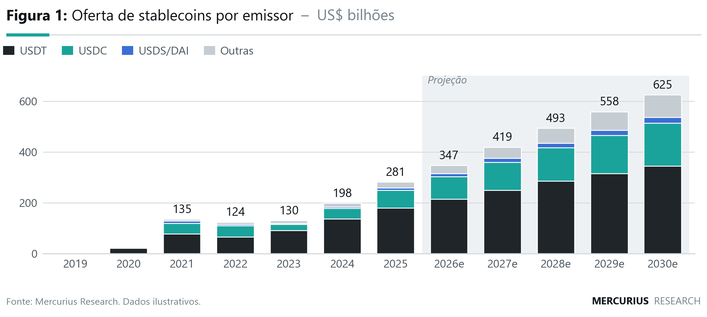
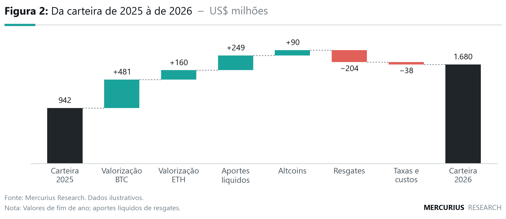
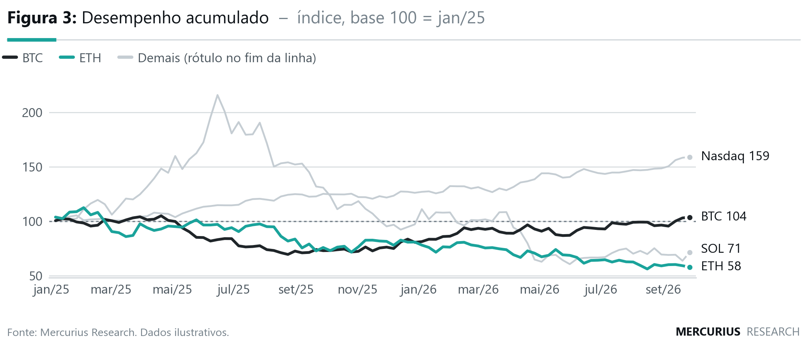
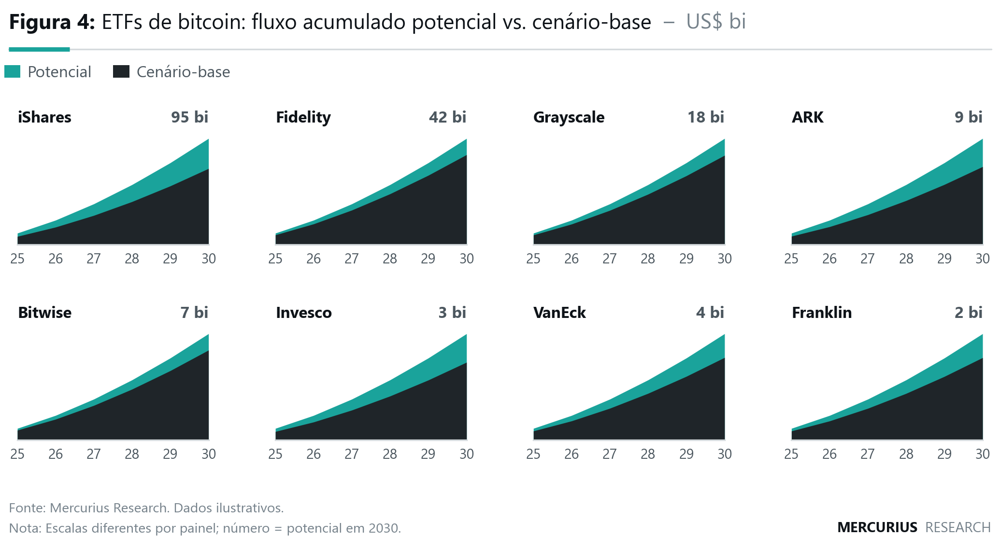
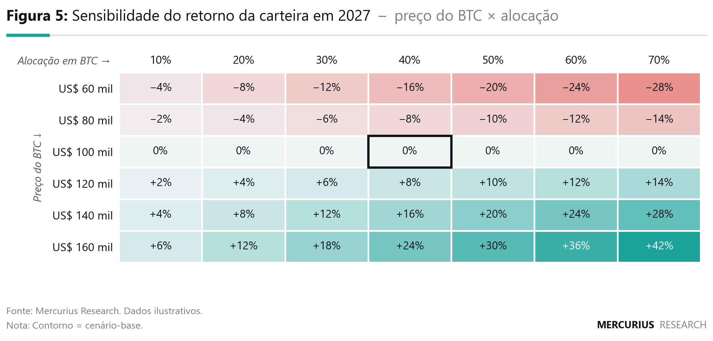
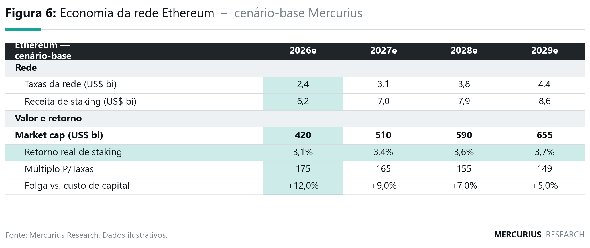
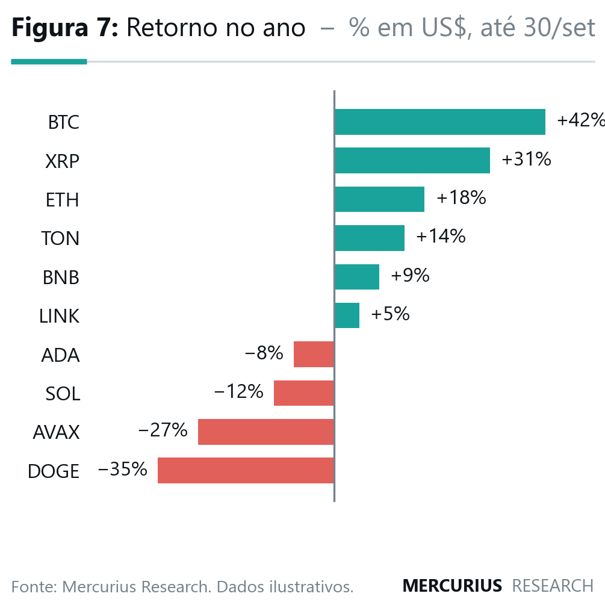
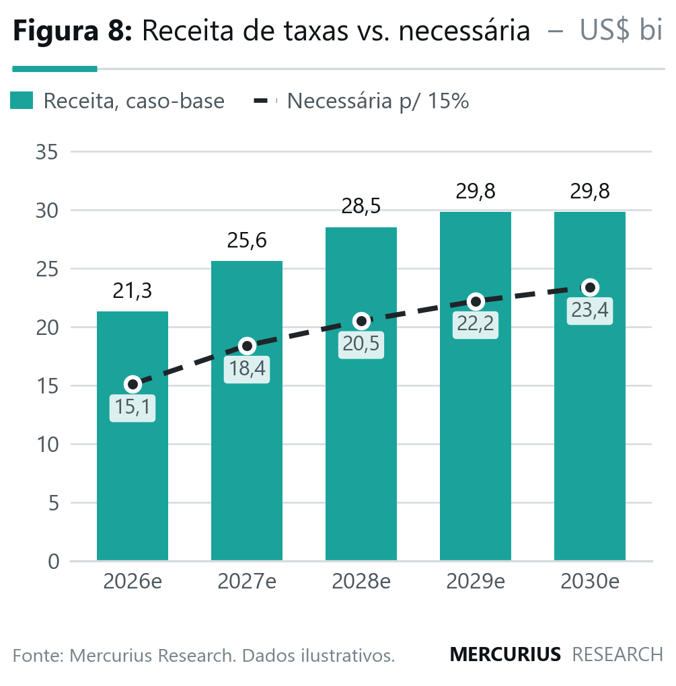
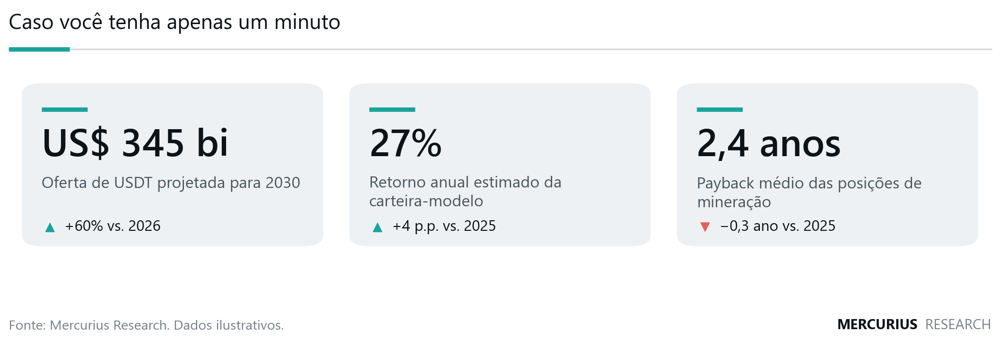
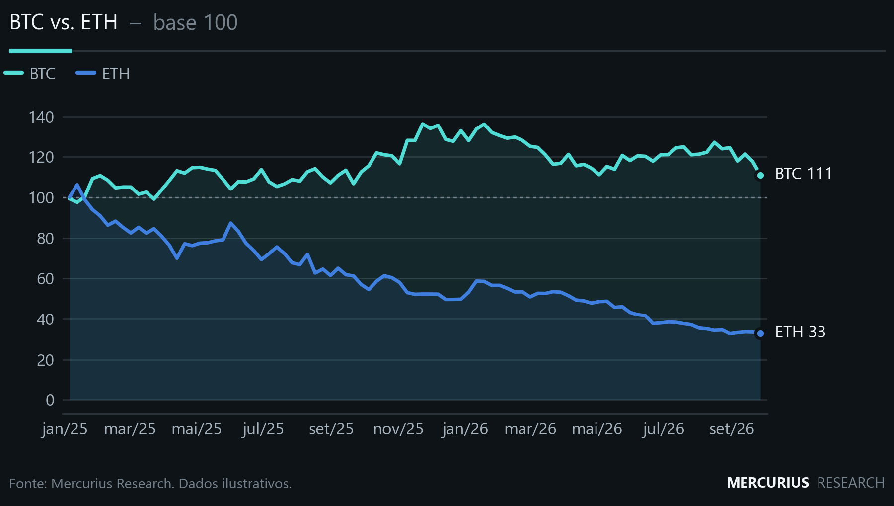

# mercurius-charts

Biblioteca de gráficos e relatórios no padrão visual **Mercurius Research**: figuras numeradas, rótulos diretos, paleta da marca e rodapé com fonte, no estilo dos relatórios sell-side (XP, BTG, GS), em Python/matplotlib.

O objetivo é simples: quem clonar o repositório escreve a análise e os gráficos já saem no nosso padrão.

```python
import mercurius_charts as mc

fig, ax = mc.figura("Oferta de stablecoins por emissor", unidade="US$ bilhões",
                    numero=1, fonte="DefiLlama e Mercurius Research.")
mc.barras_empilhadas(ax, df, projecao_desde="2026e")
mc.salvar(fig, "saida/fig01")      # -> fig01.png (300 dpi) + fig01.svg (editável no Figma)
```

## Galeria

| | |
|---|---|
|  `barras_empilhadas` |  `cascata` |
|  `linhas` |  `multiplos_area` |
|  `mapa_calor` |  `tabela` |
|  `barras_horizontais` |  `barras_com_linha` |
|  `numeros_chave` |  tema `escuro` (app e redes) |

Relatório completo de exemplo (capa + páginas): [`galeria/relatorio_exemplo.pdf`](galeria/relatorio_exemplo.pdf)

> Todos os números da galeria são **ilustrativos**.

## Instalação

```bash
pip install -e .
python scripts/baixar_fontes.py   # opcional: Inter, Outfit e JetBrains Mono (licença OFL)
python exemplos/galeria.py        # regenera a galeria
python exemplos/relatorio_exemplo.py
```

Sem as fontes da marca, a biblioteca usa Segoe UI ou Arial automaticamente.

## Estrutura

```
mercurius_charts/
  tokens.py     cores, temas (claro/escuro), tipografia, tamanhos — a fonte da verdade
  tema.py       aplica o tema ao matplotlib e registra as fontes
  figura.py     moldura: "Figura N: Título – unidade", régua, legenda, fonte, assinatura
  graficos.py   os tipos de gráfico
  formato.py    números em padrão BR: 1.388 · 27% · −204 · US$ 1,8 tri · mar/26
  relatorio.py  monta o PDF A4 (capa + páginas com texto e figuras)
exemplos/       galeria.py e relatorio_exemplo.py, para copiar e adaptar
galeria/        saídas de referência
CLAUDE.md       regras do padrão (para analistas e para IA)
```

## Tipos de gráfico

| Função | Quando usar |
|---|---|
| `barras_empilhadas(ax, df)` | composição ao longo do tempo (capex por empresa, oferta por emissor) |
| `cascata(ax, inicio, passos, fim)` | ponte entre dois totais (de 2026 a 2030, decomposição de retorno) |
| `linhas(ax, df, destaque=[...])` | séries temporais; destaque 1 ou 2 e o resto em cinza |
| `barras_horizontais(ax, s, polaridade=True)` | ranking e retornos positivos/negativos |
| `barras_com_linha(ax, barras, linha)` | realizado vs. referência **na mesma escala** |
| `multiplos_area(axes, dados)` | a mesma métrica para várias entidades (painéis pequenos) |
| `mapa_calor(ax, df, celula_ref=...)` | sensibilidade (linha × coluna) |
| `tabela(ax, df, secoes=..., calor=...)` | tabelas de modelo/premissas |
| `numeros_chave(ax, itens)` | resumo com os números principais ("caso você tenha um minuto") |

## Princípios do padrão

1. **Toda figura tem número, título, unidade e fonte.** A moldura cuida disso.
2. **Rótulos diretos no lugar de grade pesada.** Totais em cima das barras, valor final na ponta das linhas.
3. **Preto é o protagonista e o teal é o destaque.** O resto fica em cinza. No máximo 6 cores categóricas, em ordem fixa (paleta validada para daltonismo).
4. **Um único eixo y.** Duas escalas diferentes viram dois gráficos lado a lado (`grade=(1, 2)`).
5. **Projeções marcadas** com sufixo `e` (2026e) e faixa "Projeção".
6. **PNG para documentos e SVG para o Figma**, com texto editável.
